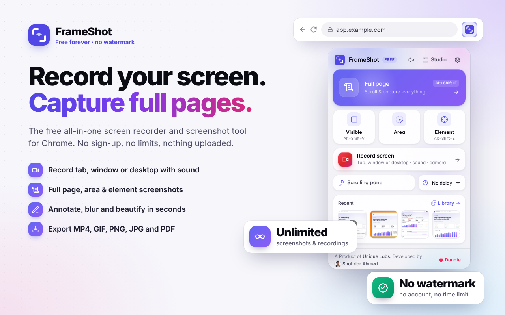
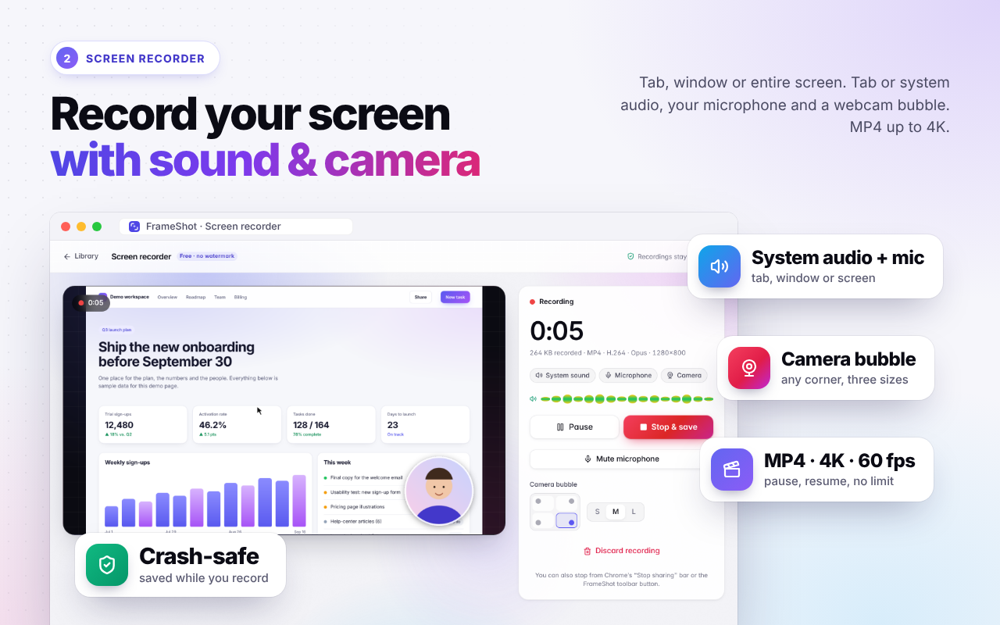
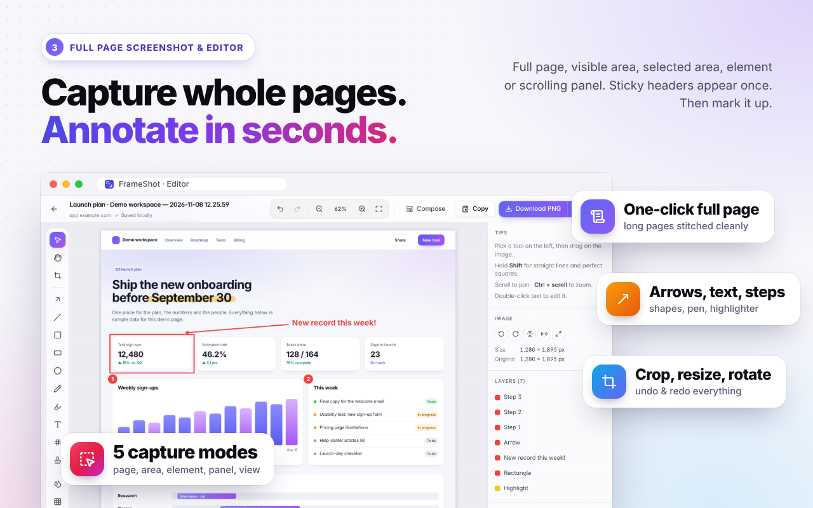
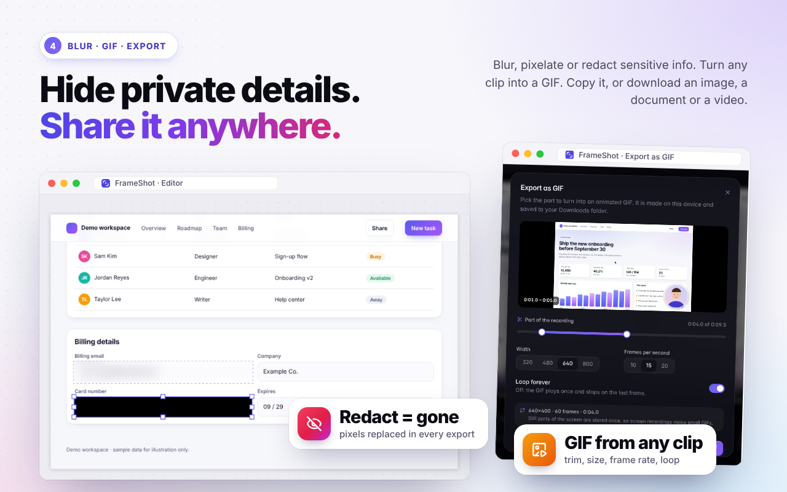
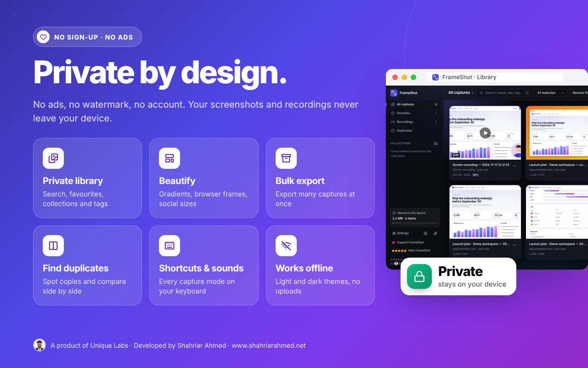
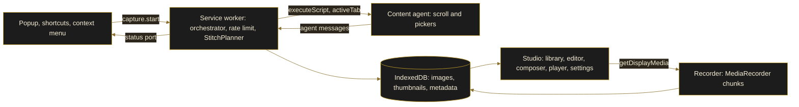

<div align="center">


<picture>
  <source media="(prefers-color-scheme: dark)" srcset="https://readme-typing-svg.demolab.com?font=Courier+New&amp;size=18&amp;duration=3200&amp;pause=800&amp;color=E6D3A3&amp;background=0B0B0B&amp;center=true&amp;vCenter=true&amp;width=780&amp;height=46&amp;lines=Capture+the+web.+Edit+every+detail.;Full-page+screenshots+for+Chrome;Screen+recorder+with+sound+and+camera;Annotate%2C+redact%2C+compose%2C+export;Local-first.+Free+forever.+No+watermark." />
  <source media="(prefers-color-scheme: light)" srcset="https://readme-typing-svg.demolab.com?font=Courier+New&amp;size=18&amp;duration=3200&amp;pause=800&amp;color=5C4A1E&amp;background=F6EED6&amp;center=true&amp;vCenter=true&amp;width=780&amp;height=46&amp;lines=Capture+the+web.+Edit+every+detail.;Full-page+screenshots+for+Chrome;Screen+recorder+with+sound+and+camera;Annotate%2C+redact%2C+compose%2C+export;Local-first.+Free+forever.+No+watermark." />
  
</picture>

<br/>

<a href="https://frameshot.uniquelabs.org"></a>
<a href="https://chromewebstore.google.com/detail/adcgjmghjagflmmndoajdidcopodacac"></a>
<a href="https://www.uniquelabs.org"></a>
<a href="CHANGELOG.md"></a>

<br/>


<br/>

**FrameShot: Screen Recorder & Full Page Screenshot** — by [Unique Labs](https://www.uniquelabs.org)

</div>

> Capture the web. Edit every detail. Free forever.
>
> *Useful technology. Accessible to everyone.*

| Slate | Mark |
|---|---|
| Production | FrameShot, a local-first Chrome extension (Manifest V3) |
| Studio | [Unique Labs](https://www.uniquelabs.org) |
| Print | `package.json` version **1.0.3**. Minimum Chrome **116** |
| House rule | Every feature is free. No plans, tiers, subscriptions, watermarks, time limits, accounts, ads, or locked features |

> **Naming notice — please read before publishing.** The name "FrameShot" has **not** been legally cleared, and a check on 2026-11-08 found a **high** conflict risk: the Chrome Web Store already lists a screenshot extension named "FrameShot" and two other "Frameshot" capture extensions, a near-identical competitor is called "FramedShot", and a US trademark filing for FRAMESHOT (serial 87795731, photo software) exists. Expect search results for the brand to be shared, and possible IP complaints. Have trademark counsel run a clearance search, and consider a more distinctive name, **before public launch**. Details: [COMPETITOR_RESEARCH.md](COMPETITOR_RESEARCH.md), addendum.

## 01. The reel

Stills already in this repository (`store-assets/screenshots/`). They are the Chrome Web Store frames: popup, recorder, editor, redaction and GIF export, and the library. Open a frame for the full 1280×800 still.

<table>
<tr>
<td align="center" width="36"><b>●<br/>●<br/>●<br/>●<br/>●<br/>●</b></td>
<td align="center">
<p align="center"><b>● &nbsp; ● &nbsp; ● &nbsp; ● &nbsp; ● &nbsp; ● &nbsp; ● &nbsp; ● &nbsp; ● &nbsp; ● &nbsp; ● &nbsp; ●</b></p>
<a href="store-assets/screenshots/01-overview.png"></a>
<p align="center"><sub>FRAME 01 — Popup. Full page, visible area, area, element, scrolling panel, record screen.</sub></p>
<p align="center"><b>● &nbsp; ● &nbsp; ● &nbsp; ● &nbsp; ● &nbsp; ● &nbsp; ● &nbsp; ● &nbsp; ● &nbsp; ● &nbsp; ● &nbsp; ●</b></p>
<a href="store-assets/screenshots/02-screen-recorder.png"></a>
<p align="center"><sub>FRAME 02 — Recorder. Tab, window, or screen, with sound, microphone, camera bubble, and crash-safe saving.</sub></p>
<p align="center"><b>● &nbsp; ● &nbsp; ● &nbsp; ● &nbsp; ● &nbsp; ● &nbsp; ● &nbsp; ● &nbsp; ● &nbsp; ● &nbsp; ● &nbsp; ●</b></p>
<a href="store-assets/screenshots/03-full-page-editor.png"></a>
<p align="center"><sub>FRAME 03 — Full page in the editor. Arrows, text, step markers, crop, resize, rotate.</sub></p>
<p align="center"><b>● &nbsp; ● &nbsp; ● &nbsp; ● &nbsp; ● &nbsp; ● &nbsp; ● &nbsp; ● &nbsp; ● &nbsp; ● &nbsp; ● &nbsp; ●</b></p>
<a href="store-assets/screenshots/04-blur-gif-export.png"></a>
<p align="center"><sub>FRAME 04 — Redaction flattened into the export, and GIF trim, width, frame rate, and loop.</sub></p>
<p align="center"><b>● &nbsp; ● &nbsp; ● &nbsp; ● &nbsp; ● &nbsp; ● &nbsp; ● &nbsp; ● &nbsp; ● &nbsp; ● &nbsp; ● &nbsp; ●</b></p>
<a href="store-assets/screenshots/05-private.png"></a>
<p align="center"><sub>FRAME 05 — Library. Search, collections, duplicates, bulk export. Captures stay on the device.</sub></p>
<p align="center"><b>● &nbsp; ● &nbsp; ● &nbsp; ● &nbsp; ● &nbsp; ● &nbsp; ● &nbsp; ● &nbsp; ● &nbsp; ● &nbsp; ● &nbsp; ●</b></p>
</td>
<td align="center" width="36"><b>●<br/>●<br/>●<br/>●<br/>●<br/>●</b></td>
</tr>
</table>

## 02. What FrameShot is

FrameShot is a **local-first Chrome extension** (Manifest V3) for capturing, recording, editing, organizing, and exporting what's on your screen. It combines a quick-capture toolbar popup with **FrameShot Studio**, a full application that opens in its own tab: a library for screenshots and recordings, a **screen recorder**, an editor with annotation and privacy tools, a composer for polished visuals, and an export engine.

Every feature is available to every user. There are no paid plans, premium tiers, subscriptions, watermarks, time limits, accounts, ads, or locked features. Screenshots and recordings stay on your device.

The manifest requires **Chrome 116** or newer. MP4 recording needs Chrome 126 or newer (see [Limitations](#12-limitations)).

| Gate | What the print holds |
|---|---|
| **Capture** | Visible area, full page, selected area, element, scrolling panel, and PDFs open in Chrome |
| **Record** | Tab, window, or entire screen, with tab or system sound, microphone, and a camera bubble |
| **Edit** | Crop, annotate, blur, pixelate, and redact. Edits stay separate from the original until you apply them |
| **Share** | PNG, JPEG, WebP, PDF, clipboard, ZIP, and GIF — with no watermark |
| **Stay private** | IndexedDB and `chrome.storage.local` only. No host permissions on a production build |

The full matrix, with test status for each item, is in [FEATURES.md](FEATURES.md).

## 03. How a session runs

1. Click the FrameShot toolbar icon. Pick **Visible**, **Full page**, **Area**, **Element**, or **Scrolling panel**. For a visible capture you can set a 3, 5, or 10 second delay. The same modes are on the right-click menu and on the shortcuts below.
2. Press **Esc** on the page to cancel. A full-page capture shows progress on the toolbar badge and offers **Stop & save**.
3. Choose **Record screen** to open the recorder in FrameShot Studio. Chrome's share picker asks what to share. Turn on the microphone or camera bubble if you want them. Pause, mute, and stop from the recorder, the popup, the Studio pill, Chrome's **Stop sharing** bar, or your shortcut.
4. Open **Studio** for the library. Edit a screenshot, compose a framed image, play a recording, save a frame, or export part of a recording as a GIF.
5. Export PNG, JPEG, WebP, or PDF, copy a PNG to the clipboard, or bulk-export a ZIP or one combined PDF. Downloads are reported as saved only after Chrome confirms they finished.

Press **?** in Studio for the full shortcut sheet.

## 04. Scenes

| Scene | What you can do |
|---|---|
| **Capture** | Viewport, full page (scroll-and-stitch), selected area, element, scrolling panel, and every page of a PDF open in Chrome |
| **Recorder** | Tab, window, or screen via Chrome's share picker. Sound, microphone, camera bubble, pause/resume, MP4 or WebM, crash recovery, GIF |
| **Editor** | Non-destructive crop, rotate, flip, resize, annotations, and privacy tools flattened into the exported pixels |
| **Composer** | Preset canvases, gradients, padding, shadow, alignment, and an optional browser-window frame |
| **Export** | PNG, JPEG, WebP, PDF, clipboard, ZIP, and one combined PDF. Filename templates. No watermarks |
| **Library** | Screenshots and recordings, search, collections, tags, favourites, duplicates, and comparison |
| **Studio** | Sounds, keyboard shortcuts, themes, and an optional review prompt that follows Chrome Web Store rules |

<details>
<summary><b>Scene A — Capture</b></summary>

- **Visible area**: the current viewport, with scrollbars trimmed. An optional 3, 5, or 10 second delay lets you capture hover menus.
- **Full page**: scroll-and-stitch capture of the whole page:
  - Sticky elements are put back in the page flow, so headers and section headers appear once, where they belong.
  - Fixed headers appear once at the top, and fixed footers once at the bottom.
  - Lazy-loaded images and infinite-scroll content are loaded before capture. A maximum height setting and a **Stop & save** button stop endless pages.
  - Horizontal overflow is captured.
  - App-shell pages, where content scrolls inside a panel, are detected and the panel's full content is captured.
  - Scroll position and every temporary page change are restored afterwards.
- **Selected area**: drag to select, resize or move with handles, and scroll the page to extend the selection beyond the viewport. Multi-frame stitching is used when needed.
- **Element**: hover to highlight any DOM element, use ↑/↓ to step to its parent or child, and click to capture it.
- **Scrolling panel**: captures the full content of an inner scroll container, such as a chat panel, table, or feed.
- **Honest oversize handling**: pages larger than the browser can hold in one image are saved as several full-resolution parts (default), or scaled into one image. FrameShot always tells you which happened, and never truncates silently.
- Start captures from the toolbar popup, the right-click menu, or keyboard shortcuts. Press **Esc** on the page to cancel.

</details>

<details>
<summary><b>Scene B — Screen recorder</b></summary>

- Record a **browser tab, an app window, or the entire screen**, chosen in Chrome's own share picker (FrameShot's own tab is never offered, so it cannot record itself). Switch to another tab mid-recording from Chrome's sharing bar.
- **Sound**: the shared tab's audio (and whole-screen system audio where Chrome offers it) plus your **microphone**, mixed into one track and recorded without voice-call processing. Mute and unmute the microphone while recording. Device picker, live level meters for the microphone and the shared sound, and guidance on what to tick in Chrome's dialog.
- **Camera bubble**: your camera in a round, mirrored bubble drawn into the video, in any corner, in three sizes; it can be moved while recording.
- Countdown (off, 3, 5, or 10 s), **pause and resume** (paused time is left out), a live preview, timer and size, and a toolbar badge (countdown, `REC`, `II`).
- Stop from the recorder, from Chrome's **Stop sharing** bar, from the popup, from a floating pill on any Studio screen, or with a keyboard shortcut you assign.
- **MP4 (H.264)** that plays everywhere, or WebM; 720p to 4K; 15, 30, or 60 fps. WebM files get a proper duration so they seek in every player.
- Recordings are saved to the library **as they are recorded** (in roughly 2-second chunks), so a crash or closed tab loses only the last few seconds; the recorder offers to recover an unfinished recording.
- A player for each recording: download, rename, favourite, delete, playback speed, keyboard shortcuts, and **Save frame** to turn any moment into a screenshot you can annotate.
- **Export as GIF**: trim the part you want (with a preview), pick the width (320–800 px), frame rate (10–20 fps) and looping. Made on your device in a background worker, with one steady palette, unchanged pixels stored once and identical frames merged, so screen recordings make small, clean GIFs.
- Needs no extra permissions. Chrome asks before the microphone or camera is used, and shows that the screen is being shared.

</details>

<details>
<summary><b>Scene C — Editor, composer, and export</b></summary>

**Editor**

- Non-destructive editing: the original is kept and edits are saved separately. They autosave locally.
- Image operations: crop (free, 1:1, 4:3, 16:9, 9:16), rotate left/right, flip horizontally/vertically, resize, zoom in/out, fit, actual size, reset.
- Annotation tools: arrow (one or both heads), line (solid or dashed), rectangle, rounded rectangle, ellipse, pen, highlighter, text (font, size, bold, outline, background), numbered step markers, and symbols (check, cross, question, warning, info, star, heart).
- Objects can be selected (with multi-select and marquee), moved, resized, duplicated, deleted, nudged with the arrow keys, and reordered. A layer list shows every object. Undo/redo keeps 100 steps.
- **Privacy tools**: blur, pixelate, and solid redaction with a selectable colour. All three are **flattened into the exported pixels**, so the original pixels are not present in the exported file.
- **Apply edits permanently** replaces the stored original, so hidden areas no longer exist even in your library.

**Composer**

- Canvas presets: fit to screenshot, 16:9, 4:3, 1:1, 4:5, 9:16, 1200×630, 1920×1080, and custom size (with aspect lock).
- Solid, gradient (six presets plus custom colours and angle), or transparent background.
- Padding, corner radius, shadow (blur, offset, opacity), fit/fill/custom scale, nine-position alignment, and an optional generic light or dark browser-window frame.
- Download, copy, or save the composition to the library.

**Export**

- PNG, JPEG, and WebP (with quality control), and PDF.
- PDF can be lossless or a smaller JPEG-compressed version. Pages can be A4 or Letter (long captures continue across pages) or sized to fit the image.
- Copy to clipboard (PNG).
- Bulk export as a ZIP archive, or as **one combined PDF**.
- Filename templates (`{name}`, `{domain}`, `{title}`, `{date}`, `{time}`, `{timestamp}`, `{mode}`, `{width}`, `{height}`) and an optional sub-folder inside Downloads.
- A download is reported as saved only after Chrome confirms it completed. No watermarks are ever added.

</details>

<details>
<summary><b>Scene D — Library, settings, sounds, and the review card</b></summary>

**Library**

- Screenshots and recordings together, with a **Recordings** view. Recording cards show a play button, length, size and format.
- Thumbnail grid and list views, with search (name, page title, domain, URL, tags, "recording") and a domain filter.
- Sort by newest, oldest, name, or size.
- Favourites, collections, tags, and rename. The details dialog shows source URL, capture mode, size, pixel density, and capture notes.
- Bulk select (Shift-click ranges), bulk export (recordings go into ZIP files as their video files; PDFs hold images only), move to collection, favourite, and delete, with confirmation.
- Duplicate detection (perceptual hash) and screenshot comparison (side by side, overlay, pixel difference).
- Import images by file picker, paste, or drag and drop.
- Storage usage display and a **Clear all local data** option.

**Settings**

Theme (system, light, dark), default format and quality, filename template, download folder, ask where to save, capture behaviour (fixed-element handling, lazy-content preload, animation freezing, horizontal overflow, scroll delay, maximum height, oversize handling, what happens after a capture), screen-recording defaults (format, quality, frame rate, countdown, tab sound), PDF page size and margin, a keyboard shortcut overview, storage, privacy, and about.

**Sounds and shortcuts**

- Gentle sound effects: a camera shutter when a screenshot is saved (also for captures started from the toolbar, menu or keyboard), a countdown, start/stop and pause/resume chimes for recordings, and a chime when an export is ready. Recording chimes finish before recording starts or resumes, so they are never recorded. Turn them off or change the volume in **Settings → Sounds**, or with the speaker button in the popup.
- Press **?** anywhere in the Studio for every keyboard shortcut. The library supports **/** (search), **Ctrl/⌘ + A**, **Delete** and **Esc**; the player supports Space, ←/→, `,` `.`, F, M, S and G.

**Review prompt**

After you have used FrameShot for a while (at least 3 captures or recordings and 2 days), it may ask — at most three times, 3 weeks apart, never in the middle of a task — whether you would rate it on the Chrome Web Store. The card shows five gold stars you can click, and everyone sees the same choices: **Rate FrameShot**, **Not now**, or **Don't ask again**. It follows the Chrome Web Store's rules: no incentives, no requests for a particular rating, and no filtering of unhappy users. Rating is also available any time from the **★★★★★ Rate FrameShot** link in the library sidebar and under **Settings → About**.

**Interface**

A calm, minimal design over a slowly drifting aurora background: glass surfaces, one gradient accent, and fluid motion — page transitions, animated dialogs, menus and toasts, staggered card entrances, and hover and press feedback. Light and dark themes (or follow the system), with a one-click theme switch in the library. All animation is turned off when your system asks for reduced motion.

</details>

## 05. Stack

| Layer | Choice |
|---|---|
| Extension | [WXT](https://wxt.dev) 0.21, Chrome Manifest V3, minimum Chrome 116 |
| UI | React 19, TypeScript 5.9, Tailwind CSS 4, Radix UI primitives, Lucide icons |
| Build | Vite 8 |
| Storage | IndexedDB via `idb`, plus `chrome.storage.local` for settings |
| PDF | `pdfjs-dist` 4.10 (bundled) to render PDFs; `pdf-lib` to write PDF exports |
| GIF | `gifenc`, encoded in a background worker |
| Tests | Vitest 5 (unit), Playwright 1.63 (real-browser end-to-end) |
| Website | Static pages in `website/`, deployed on Vercel. Live at [frameshot.uniquelabs.org](https://frameshot.uniquelabs.org) |
| Install counts | Optional Cloudflare Worker in [`server/telemetry/`](server/telemetry/) |

Production permissions: `activeTab`, `scripting`, `storage`, `unlimitedStorage`, `downloads`, `contextMenus`, `offscreen`. There are **no host permissions**. Screen recording added none; `offscreen` only plays sound effects for background captures.

## 06. Load a print

Requirements: **Node.js 20 or newer** (developed on Node 22), npm, and Chrome 116+.

### From source (load unpacked)

```bash
npm install
npm run build
```

1. Open `chrome://extensions` in Chrome.
2. Turn on **Developer mode**.
3. Click **Load unpacked** and choose the `.output/chrome-mv3` folder.
4. Pin FrameShot: open the puzzle-piece menu and click the pin.

`npm run dev` writes a development build to `.output/chrome-mv3-dev`. Load that folder the same way while you are iterating. See [Develop](#07-develop).

### Packaged ZIP

```bash
npm run zip
```

This produces `.output/frameshot-<version>-chrome.zip` (for the current `package.json` version, `.output/frameshot-1.0.3-chrome.zip`), the archive to upload to the Chrome Web Store. Do not submit without owner approval; see [RELEASE_CHECKLIST.md](RELEASE_CHECKLIST.md).

The published listing is [FrameShot on the Chrome Web Store](https://chromewebstore.google.com/detail/adcgjmghjagflmmndoajdidcopodacac). The marketing site is [frameshot.uniquelabs.org](https://frameshot.uniquelabs.org).

### Call sheet — keyboard shortcuts

| Action | Suggested shortcut |
|---|---|
| Capture visible area | Alt+Shift+V |
| Capture full page | Alt+Shift+F |
| Capture selected area | Alt+Shift+A |
| Capture an element | Alt+Shift+E |
| Start or stop a screen recording | not set by default |
| Open Studio / library, cancel capture | not set by default |

Chrome assigns suggested shortcuts only if they don't conflict with existing ones. You can view and change them at `chrome://extensions/shortcuts`, or from **Settings → Keyboard shortcuts → Customize shortcuts**. Pressing **Esc** on the page always cancels an active capture.

## 07. Develop

```bash
npm run dev
```

`npm run dev` starts WXT in development mode with hot reload.

| Script | Purpose |
|---|---|
| `npm run dev` | WXT dev mode (development build with reload) |
| `npm run build` | Production build → `.output/chrome-mv3` |
| `npm run zip` | Production ZIP → `.output/frameshot-<version>-chrome.zip` |
| `npm run build:e2e` | E2E test build → `.output/chrome-mv3-e2e` |
| `npm run compile` | TypeScript type check (`tsc --noEmit`) |
| `npm test` | Unit tests (Vitest) |
| `npm run test:e2e` | E2E build, then real-browser tests (Playwright) |
| `npm run icons` | Re-render PNG icons from `src/assets/logo*.svg` |
| `npm run website` | Build the static website into `website/` (see [WEBSITE.md](WEBSITE.md)) |
| `npm run website:check` | Check the built website in a real browser (links, console errors, images, structured data) |
| `npm run video` | Capture the UI, synthesize the soundtrack and render the showcase video (see [marketing/VIDEO.md](marketing/VIDEO.md)) |

How to contribute, and the rules that keep FrameShot free and local-first, are in [CONTRIBUTING.md](CONTRIBUTING.md).

## 08. Slate marks

The extension has no `.env` file and no API keys. These names are build flags, website overrides, and the install-count Worker. Never commit secret values.

| Name | Where | What it is |
|---|---|---|
| `FRAMESHOT_E2E` | `npm run build:e2e` sets it to `1` | Builds the end-to-end variant. Adds `host_permissions: ["<all_urls>"]` and test hooks. Production builds never set it. |
| `SITE_URL` | `scripts/website/config.mjs` | Public site origin used for canonical links, the sitemap, and social previews. Default `https://frameshot.uniquelabs.org`. |
| `STORE_URL` | `scripts/website/config.mjs` | Chrome Web Store listing used by "Add to Chrome". Default is the listing linked above. A one-off website build can pass `SITE_URL` and `STORE_URL` in the environment. |
| `PORT` | `npm run website:serve` | Port for the local website server. Default `4173`. |
| `DB` | Cloudflare Worker binding | D1 database binding name. Must stay `DB`. Not a secret. |
| `STATS_KEY` | Worker secret | Optional password for the install-count dashboard. Set it in the Cloudflare dashboard or with `npx wrangler secret put STATS_KEY`. The value never belongs in the repo. |

The extension talks to one origin, `https://frameshot.shahriarahmed614.workers.dev`, and only for anonymous install counts. To point that at a different Worker, change `TELEMETRY_ORIGIN` in `src/core/telemetry.ts`, `wxt.config.ts`, and `scripts/check-bundle.mjs`, then rebuild. Setup steps are in [server/telemetry/README.md](server/telemetry/README.md).

## 09. Floor plan

```
src/entrypoints/     WXT entrypoints: background, capture agent, popup, studio, options, offscreen
src/background/      Capture orchestrator, stitcher, badge, commands, menus
src/content/         In-page agent: scroll, sticky/fixed handling, pickers, restore
src/core/            Messages, capture planner, geometry, settings, filenames, telemetry
src/editor/          Document model, annotation rendering, editor UI
src/composer/        Framed compositions
src/recorder/        Screen recorder, player, GIF export
src/export/          PDF, ZIP, downloads, clipboard
src/library/         Library UI, duplicates, import
src/imaging/         Blur, pixelate, redact, image I/O
src/db/              IndexedDB
src/popup/  src/settings/  src/app/  src/ui/
server/telemetry/    Cloudflare Worker for anonymous install counts
website/             Static marketing site
tests/unit  tests/e2e
```

## 10. Continuity



| Path | Module |
|---|---|
| `src/entrypoints/` | WXT entrypoints: `background.ts`, `capture-agent.ts`, `popup/`, `studio/`, `options/` |
| `src/background/` | Service worker: orchestration, rate-limited frame capture, segmented stitcher, status/badge, commands, menus |
| `src/content/` | Content agent (scrolling, sticky/fixed handling, preload, restore) and in-page pickers |
| `src/core/` | Pure shared logic: message contracts, capture planner, geometry, settings, filenames, restricted URLs |
| `src/imaging/` | Pixel effects (blur/pixelate/redact), image I/O, thumbnails, perceptual hash |
| `src/editor/model/` | Immutable document model, transforms, object geometry, editor store (undo/redo) |
| `src/editor/render/` | Shared annotation drawing, tiled base image, view renderer, export flattening |
| `src/editor/ui/` | Editor screen, canvas interaction, toolbar, properties panel |
| `src/composer/` | Composer layout (pure), renderer, UI |
| `src/export/` | PDF writer, ZIP writer, downloads/clipboard, export service, export dialog |
| `src/db/` | IndexedDB persistence and change notifications |
| `src/library/` | Library UI, filtering, duplicate detection, importer |
| `src/recorder/` | Screen recorder: engine, camera compositor, audio mixer, format choice, WebM duration repair, GIF export (worker encoder), recorder and player screens, popup/badge channel |
| `src/core/sound-synth.ts`, `src/ui/sounds.ts`, `src/background/sound.ts`, `src/entrypoints/offscreen/` | Synthesized sound effects: in pages directly, and for the service worker through an offscreen document |
| `src/settings/`, `src/popup/`, `src/app/`, `src/ui/` | Settings, popup, Studio shell/welcome/compare, design-system components |

Full details are in [ARCHITECTURE.md](ARCHITECTURE.md).

## 11. Dailies

```bash
npm test
npm run test:e2e
```

- **Unit tests** (Vitest, Node) cover the stitching planner, geometry, settings validation, filename templates, pixel effects, editor transforms and store, object geometry, PDF and ZIP writers, IndexedDB storage (`fake-indexeddb`), composer layout, annotation rendering, and the recorder's pure parts (format choice, WebM duration repair, bubble geometry, chunked recording storage).
- **End-to-end tests** (Playwright) load the unpacked extension into Chromium (channel `chromium`, new headless mode; Chrome for Testing). They drive real captures against deterministic fixture pages, then verify the stitched output **pixel by pixel**. They also verify exported PNG/JPEG/WebP/PDF files and the clipboard contents (including that redacted pixels are gone), plus the library, composer, popup, settings, shortcuts, CSP network blocking, and offline use. Screen-recording tests use Chromium's fake camera, microphone and share picker to record real MP4 and WebM files and check their length, sound, the camera bubble's pixels, pause handling, crash recovery, downloads and the popup controls.
- Branded Google Chrome 137+ no longer supports `--load-extension`, so automated tests use Playwright's Chromium (Chrome for Testing).
- The E2E build is identical to production except for two things. It adds `host_permissions: ["<all_urls>"]`, because automation cannot click the toolbar to grant `activeTab`. It also includes test hooks (`__frameshotTest` on the service worker, `__frameshotEditor` on the editor window, `__frameshotRecorder` on Studio pages), compiled in only when `__FRAMESHOT_E2E__` is true. Production builds contain neither.

Details, coverage, and the latest results are in [TESTING.md](TESTING.md).

## 12. Limitations

<details open>
<summary><b>Unsupported because of browser restrictions</b></summary>

- **PDFs** open in Chrome: Visible area works as on any page. **Full page** renders every page of the PDF (with pdf.js, bundled) into one tall image, split at page boundaries if it is very long. Chrome never lets extensions read PDF files from your computer (`file://`), so for those FrameShot asks you to choose the same file once. Password-protected PDFs ask for the password, which is only used on your device.
- **Other extensions' pages and `chrome://` pages**: Chrome allows a screenshot of what's on screen but no scripts, so Full page, Area, Element and Scrolling panel save the visible part, with a note saying why (crop it in the editor). The Chrome Web Store can't be captured at all. FrameShot explains this instead of failing silently.
- Local `file://` pages require **Allow access to file URLs** to be turned on for FrameShot in `chrome://extensions`.
- Chrome limits screenshots to **two per second** per extension. A full-page capture therefore takes about half a second per screen of content.
- Canvas size is limited (up to 32,767 px per side, with a memory budget of about 100 megapixels per image). Larger pages are split into parts or scaled down, depending on your settings.
- The tab must stay visible during a multi-frame capture. Switching tabs, minimizing the window, or resizing or zooming stops the capture with a clear message.

</details>

<details>
<summary><b>Screen recording limits (Chrome)</b></summary>

- Chrome records sound from **tabs** on every system. Whole-screen system sound is offered on Windows and ChromeOS, and on macOS 14.2+ with Chrome 141+ (tick "Also share system audio" in Chrome's dialog). A single app window never has sound. The recorder shows a hint for your system before you start and a banner if no sound is coming in.
- The recorder runs in a FrameShot Studio tab, which must stay open while recording (closing it asks for confirmation; an interrupted recording can be recovered, minus the last few seconds).
- MP4 needs Chrome 126 or newer and an H.264 encoder; elsewhere recordings are saved as WebM, and FrameShot says so. MP4 sound is AAC where Chrome can encode it (Windows, macOS) and Opus elsewhere.
- The camera bubble needs Chrome's frame-processing APIs (available in current Chrome); without them FrameShot records the screen only and says so.

</details>

<details>
<summary><b>Known limitations</b></summary>

- On app-shell pages, FrameShot captures the full content of the main scrolling panel. Fixed app chrome around that panel (toolbars, sidebars) is not repeated.
- Sticky and fixed elements inside cross-origin iframes or closed shadow DOM are not adjusted. Open shadow roots are handled.
- Pages that keep changing while they are captured (auto-rotating carousels, live feeds) may show changes between frames. FrameShot warns when page height changes. If it cannot prove the image is complete, it refuses to save and asks you to retry.
- Blur and pixelation can sometimes be reversed for short or predictable text. Use **Redact** for passwords, card numbers, and personal data. The editor shows this warning.
- "Unlimited captures" and "no time limit" mean FrameShot sets no limits. Your disk space, browser storage quota, and memory still apply. Very large captures can be slow on low-memory machines.
- Keyboard shortcuts depend on Chrome assigning them. Conflicting shortcuts stay unset until you choose them.
- English only for now.

</details>

<details>
<summary><b>Not fully verified by automation</b></summary>

- A real click on the toolbar icon and physical keyboard-shortcut presses can't be automated, so the same code paths are exercised through test hooks. Both need a manual check before release (see [TESTING.md](TESTING.md)).
- Screen recording is tested with Chromium's fake devices and fake share picker (which shares a tab). Recording a real window or screen, real system audio, real microphones and cameras, and long recordings (an hour or more) need a manual check on each platform before release.

</details>

## 13. Still in the can

Nothing on the roadmap becomes a paid feature, and nothing there adds accounts, cloud storage, or tracking unless it is explicitly optional and local-first. The full list is in [ROADMAP.md](ROADMAP.md).

| Deferred | Why it waits |
|---|---|
| Trimming and cutting recordings | Needs a local video editor (WebCodecs). Planned, local-only. |
| Drawing on the screen while recording | Needs an overlay in the recorded tab, or a picture-in-picture canvas. |
| Local OCR and searchable screenshot text | Needs a bundled OCR engine and a looser CSP. Text recognition must stay on the device. |
| Batch capture of several tabs | Would need an optional host permission, requested only when the feature is used. |
| Export presets, per-object rotation, custom font upload | Settings and editor follow-ups. Text uses bundled Inter and system font stacks today. |
| Microsoft Edge / Firefox, translations | Edge is close; Firefox needs Manifest V3 differences. The UI is English only. |
| Optional sync between devices | Not planned. It would conflict with the local-first promise unless it were strictly opt-in and end-to-end encrypted. |

Also still open: trademark clearance for the name (see the notice at the top), and a CI workflow running `npm test` and `npm run test:e2e` on every push. There is no CI workflow in this repository yet.

## 14. What stays on set

- **Your captures never leave your device.** There are no accounts, ads, usage analytics or remote code.
- **Anonymous install counts only.** On install and update FrameShot sends a random install ID, its version, the OS family and the browser language to its own Cloudflare Worker ([`server/telemetry/`](server/telemetry/)), and Chrome opens the Worker's uninstall page on removal. Users turn it off in **Settings → Privacy**; test builds never send anything.
- Screenshots, recordings, edits, and settings are stored only in this browser (IndexedDB and `chrome.storage.local`).
- The microphone and camera are used only while you record, after you switch them on, and Chrome asks for your permission. Screen recording uses Chrome's share picker, so you choose exactly what is recorded.
- Extension pages run under a strict Content Security Policy that **blocks connections to every server except the install-count Worker** (`connect-src 'self' blob: data: https://frameshot.shahriarahmed614.workers.dev`). This is verified by an automated test.
- **Minimal permissions**: `activeTab`, `scripting`, `storage`, `unlimitedStorage`, `downloads`, `contextMenus`, `offscreen`. There are **no host permissions**, so FrameShot can access a tab only when you start a capture on it. Screen recording added no permissions; `offscreen` only plays sound effects for background captures and shows no install warning.
- Exported files contain only what you see. Privacy effects are flattened, and no watermark is added.

See [PRIVACY.md](PRIVACY.md) and [SECURITY.md](SECURITY.md).

## 15. Paper trail

| Document | Contents |
|---|---|
| [FEATURES.md](FEATURES.md) | Feature matrix with test status |
| [ARCHITECTURE.md](ARCHITECTURE.md) | Modules, message contracts, capture and editor internals |
| [TESTING.md](TESTING.md) | Test suites, how to run, results, manual checks |
| [PRIVACY.md](PRIVACY.md) | Privacy policy |
| [PRIVACY_DISCLOSURE.md](PRIVACY_DISCLOSURE.md) | Chrome Web Store privacy-practices answers |
| [SECURITY.md](SECURITY.md) | Threat model and security measures |
| [STORE_LISTING.md](STORE_LISTING.md) | Store listing copy and permission justifications |
| [RELEASE_CHECKLIST.md](RELEASE_CHECKLIST.md) | Release steps |
| [ROADMAP.md](ROADMAP.md) | Deferred and planned work |
| [CONTRIBUTING.md](CONTRIBUTING.md) | How to contribute |
| [CHANGELOG.md](CHANGELOG.md) | Version history |
| [COMPETITOR_RESEARCH.md](COMPETITOR_RESEARCH.md) | Market research and brand availability |
| [WEBSITE.md](WEBSITE.md) | The marketing website: pages, Vercel deployment, store link, editing content |
| [marketing/VIDEO.md](marketing/VIDEO.md) | The 2-minute showcase video: scenes, male AI narration, original soundtrack, captions, how to render it again |
| [marketing/YOUTUBE.md](marketing/YOUTUBE.md) | YouTube upload kit: title, description with chapters, tags, thumbnails, upload settings |
| [marketing/LINKEDIN.md](marketing/LINKEDIN.md) | LinkedIn kit: project fields, description, skills, media, profile banner, launch post |

## 16. House lights

FrameShot is free forever and nothing is locked. If it saves you time, the **Support FrameShot** page (library sidebar, popup footer, or Settings → About) lists donation addresses with QR codes and a Copy button, and free ways to help. The same page is on the website at [frameshot.uniquelabs.org/support](https://frameshot.uniquelabs.org/support).

| Network | Address |
|---|---|
| EVM (ETH, USDT, BNB, AVAX, …) | `0x257F291514AaAa1533832cC2C8981Cc14063ED17` |
| Solana | `GwwZWYxzms9ebEWQNCAJrPSQdsN6SVPGbpMwCYomWqWa` |
| Bitcoin | `bc1qg6clyevlmfekg3rkyhlk5ggeh3g6dnt5sdje4j` |
| Telegram | [Shahriar Ahmed](https://t.me/igfrostt) |

The QR codes are generated by `scripts/build-donate-qr.py`, which checks that each one decodes to the exact address. Donating unlocks nothing.

## 17. End credits

<div align="center">

**FrameShot** by [Unique Labs](https://www.uniquelabs.org). Free forever.

A product of Unique Labs. Developed by [Shahriar Ahmed](https://github.com/fr-ost) · [shahriarahmed.net](https://www.shahriarahmed.net)

Co-Founder & COO, Unique Labs


</div>
