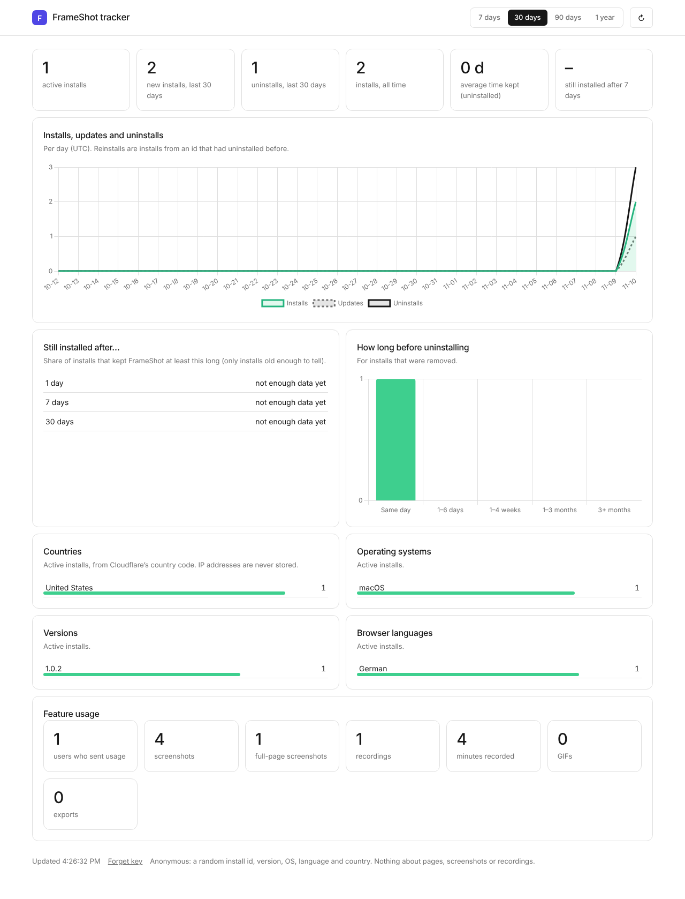

# FrameShot tracker

A small Cloudflare Worker with a built-in dashboard that counts FrameShot
installs anonymously:

- **installs, updates and uninstalls** per day, and **active installs**
- **retention**: the share of installs still there after 1, 7 and 30 days, and
  how long removed installs were kept
- **versions** in use
- **country** (Cloudflare's 2-letter code for the request), **operating
  system** and **browser language**
- **feature usage**: the Worker already accepts feature counts (screenshots,
  recordings, GIFs, exports) for a later FrameShot version. FrameShot 1.0.1
  doesn't send any, so this section of the dashboard says so and stays empty.



*The dashboard running locally with a few test events, not real numbers.*

It runs on Cloudflare's **free plan**: Workers (100,000 requests a day) and a
**D1** database (5 GB, 100,000 row writes a day). Install counts use a few
requests per user per year, so the free plan covers a very large number of
users.

---

## What FrameShot sends (and what it never sends)

| Event | When | Fields |
|---|---|---|
| `install` | first install | random id, version, OS, browser language |
| `update` | after an update (also the first event from people who had 1.0.0) | the same, plus the previous version |
| uninstall | when FrameShot is removed (Chrome opens `/u`) | random id, version |

If an event can't be delivered (offline), FrameShot retries it once at the next
browser start.

**Never sent:** page addresses or titles, screenshots, recordings, file names,
settings, names, emails or IP addresses. The id is 32 random hex characters
the extension makes up for itself (`src/core/telemetry.ts`). The country comes
from Cloudflare; the Worker stores only the 2-letter code, never the IP. Users
turn all of this off in FrameShot under **Settings → Privacy → Share anonymous
install counts**, which also deletes the id and the uninstall ping.

What the database keeps:

| Table | One row per | Columns |
|---|---|---|
| `installs` | random install id | first / last seen, version, OS, language, country, number of updates, uninstalled at, version at uninstall |
| `counts` | day (UTC) and event | number of installs, reinstalls, updates and uninstalls |
| `usage` | install and day | feature counts (empty until a FrameShot version sends them); deleted after 400 days |

---

## Set it up in the Cloudflare dashboard (no terminal, about 5 minutes)

FrameShot 1.0.1 sends to **`https://frameshot.shahriarahmed614.workers.dev`**.
So the Worker must be called **`frameshot`**, on the same Cloudflare account as
the GrowX Worker (the `shahriarahmed614` subdomain). If you use another name or
account, see [Using a different address](#using-a-different-address).

### 1. Create the Worker

1. Open [dash.cloudflare.com](https://dash.cloudflare.com) and sign in.
2. Go to **Compute (Workers) → Workers & Pages → Create → Create Worker**.
3. Name it **`frameshot`** and click **Deploy**. The address shown should be
   `https://frameshot.shahriarahmed614.workers.dev`.

### 2. Put the code in

1. Click **Edit code**.
2. Select everything in the editor (`Ctrl+A` / `Cmd+A`) and delete it.
3. Open [`worker.js`](worker.js) from this folder, copy the **whole file**, and
   paste it in.
4. Click **Deploy**.

### 3. Create the database and connect it

1. Go to **Storage & Databases → D1 SQL Database → Create**. Name it
   `frameshot-telemetry`, leave the location on *Automatic*, click **Create**.
   You don't need to run any SQL; the Worker creates its tables itself.
2. Open the **frameshot** Worker → **Settings → Bindings → Add binding → D1
   database**.
3. **Variable name:** `DB` (capitals, exactly). **Database:**
   `frameshot-telemetry`. Click **Add binding**.

### 4. Protect the dashboard with a password (recommended)

1. In the Worker's **Settings → Variables and Secrets**, click **Add**.
2. Type **Secret**, name `STATS_KEY`, value: any long password.
3. Click **Deploy**.

The dashboard asks for it once and remembers it in that browser.

### 5. Open the dashboard

Go to **https://frameshot.shahriarahmed614.workers.dev**.

- Pick **7 days / 30 days / 90 days / 1 year** at the top right. ↻ refreshes
  (it also refreshes by itself every 2 minutes).
- It follows your system's light or dark mode.

Numbers appear once people install or update to FrameShot 1.0.1. Everyone on
1.0.0 shows up as an `update` when Chrome updates them.

Check it works before publishing 1.0.1: open
`https://frameshot.shahriarahmed614.workers.dev/health`; it should say `ok`.

---

## Using a different address

If the Worker lives somewhere else (another name, account or a custom domain),
change the address in **three** places, then rebuild the extension
(`npm run build && npm run zip`):

- `src/core/telemetry.ts` → `TELEMETRY_ORIGIN`
- `wxt.config.ts` → `TELEMETRY_ORIGIN` (the manifest's `connect-src`)
- `scripts/check-bundle.mjs` → `TELEMETRY_ORIGIN` and the matching
  `ALLOWED_URL` entry

A unit test fails if the first two don't match.

### With a terminal instead (optional)

```sh
cd server/telemetry
npx wrangler login
npx wrangler d1 create frameshot-telemetry   # copy the database_id into wrangler.toml
npx wrangler deploy
npx wrangler secret put STATS_KEY
```

Local test: `npx wrangler dev --local` runs the Worker with a local D1 at
http://localhost:8787.

---

## API

| Method and path | What it does |
|---|---|
| `GET /` | the dashboard |
| `GET /api/stats?days=7\|30\|90\|365` | the dashboard's numbers as JSON. When `STATS_KEY` is set, send it as the `x-stats-key` header (or `?key=`) |
| `POST /e` | event intake used by the extension (JSON body, up to 2 KB; unknown fields are ignored) |
| `GET /u?id=&v=` | uninstall address: records the uninstall once per id and shows a "FrameShot was removed" page with feedback and reinstall links |
| `GET /health` | `ok` |

Event body:

```json
{ "ev": "install", "id": "3f9c…32 hex chars", "v": "1.0.1", "p": "win", "l": "en" }
{ "ev": "update",  "id": "3f9c…", "v": "1.0.2", "pv": "1.0.1", "p": "mac", "l": "de" }
{ "ev": "usage",   "id": "3f9c…", "sv": 3, "sf": 1, "sa": 0, "se": 0, "rc": 1, "rm": 4, "gf": 0, "ex": 2 }
```

`usage` counts (since the previous report): `sv`/`sf`/`sa`/`se` visible,
full-page, area and element screenshots, `rc` recordings, `rm` recorded
minutes, `gf` GIFs, `ex` exports. FrameShot 1.0.1 doesn't send `usage`; adding
it later also needs a privacy-policy and store-disclosure update.

Example: `curl -H "x-stats-key: YOUR_KEY" "https://frameshot.shahriarahmed614.workers.dev/api/stats?days=7"`

---

## Troubleshooting

| You see | Fix |
|---|---|
| "Almost there" page, or `No D1 database is bound as DB` | Step 3: the binding must be a **D1 database** with the variable name `DB`. |
| The dashboard asks for a key you don't know | Set a new `STATS_KEY` (step 4), then click **Forget key** at the bottom of the dashboard. |
| Tiles show numbers but no charts | The charts load Chart.js from `cdnjs.cloudflare.com`; a blocker can stop that. The tables still work. |
| Everything is 0 | Nobody has installed or updated to 1.0.1 yet, or the Worker's address isn't `frameshot.shahriarahmed614.workers.dev` (see above). |
| `Error 1101` | The code wasn't pasted completely. Paste the whole `worker.js` again and deploy. |
